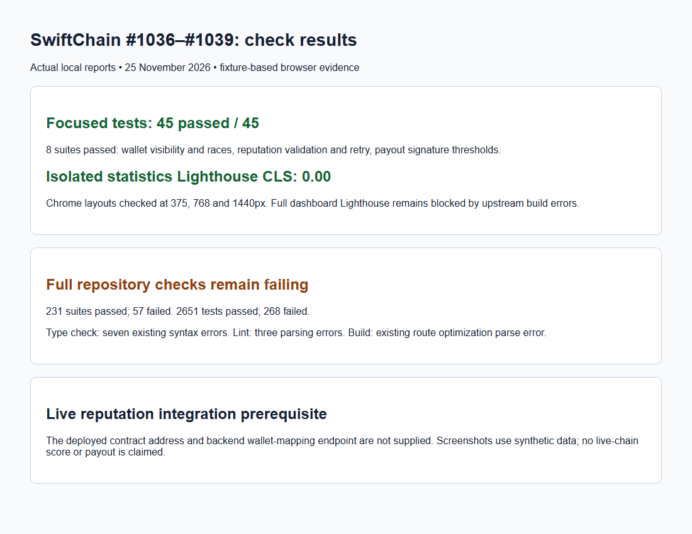

# Validation for SwiftChain #1036, #1037, #1038, #1039

Base: main at caa7902. Four issue branches are merged into integrate/swiftchain-1036-1039. No other organization/project or issue implementation is included.

## Focused checks

Eight Jest suites / 45 tests pass. These use the real hooks at the service boundary for balance races, reputation retry and payout thresholds; production components do not receive inline mock data.

Run:

```sh
pnpm install --frozen-lockfile
pnpm exec jest --runInBand --runTestsByPath hooks/__tests__/useDriverReputation.retry.test.tsx components/wallet/__tests__/BalanceWarning.test.tsx hooks/__tests__/useWalletBalance.race.test.tsx services/__tests__/walletBalance.race.test.ts components/fleet/__tests__/DriverReputation.test.tsx services/__tests__/reputationService.test.ts services/__tests__/sorobanReputationService.test.ts __tests__/components/escrow/PayoutUI.test.tsx
pnpm lint
pnpm type-check
pnpm exec jest --runInBand
pnpm build
```

The repaired pnpm lockfile installs with frozen-lockfile. Both package lockfiles include Stellar SDK 17.0.1. Changed TypeScript/TSX files pass ESLint; the UI detector reports no findings.

## Chrome evidence

An isolated preview bundled the real components with their hooks, QueryClient and CurrencyProvider. Admin statistics, exchange rates and wallet balance came through test HTTP responses. Only the preview's Soroban and existing stub escrow service boundaries used fixture adapters. The production code never imports these preview fixtures. Screenshots are explicitly labelled test data. They are not a live-node or payout demonstration.

At widths 375, 768 and 1440 pixels, the lazy statistics skeleton and loaded cards have identical positions and widths; all six cards remain 136px high. The exact same presentation component is used before lazy import, during data fetch and after data arrives. Chrome recorded isolated Statistics CLS 0 at every width. Lighthouse 13.6.0 independently measured CLS **0.00** on the isolated Statistics preview; this is not the entire dashboard score.

Dismissing the balance warning leaves the payment-controls document position unchanged at every width. The reputation dialog opens, supports Escape, and displays separately from the platform rating. The payout UI renders an actually disabled button at 1/2 and an enabled button at 2/2. No live transaction was sent. No browser JavaScript errors occurred.

The real Stellar SDK also round-tripped the DriverProfile(Address) storage key and synthetic profile XDR. The production reader processed those ledger bytes through the SDK parser, returning score 80 and ledger sequence 123. This validates SDK compatibility, not deployment availability.

## Full repository failures and limits

The complete test run finished: **231 suites passed / 57 failed; 2,651 tests passed / 268 failed**. An isolated original-main worktree reproduced **55 failed suites / 265 failed assertions**, with exactly the same assertion names. The remaining two suites had three 5-second timeouts in the busy full run. Both suites passed on an isolated rerun: all eight tests passed.

Full type-check reports seven syntax errors in the unchanged QrScannerScreen.tsx, useRouteOptimization.ts and routeOptimizationService.ts. Lint reports the corresponding three parsing errors (plus warnings). Production build stops at useRouteOptimization.ts. A narrower compile reports the existing nullable-ref mismatch in AnalyticsCharts/useInView and duplicate unrelated multisignature methods in walletService; no new reputation/statistics/balance code errors are reported. Those unrelated features were left in their assigned owners' scope.

Because the application cannot build on the baseline, full-dashboard Lighthouse CLS cannot be verified. This remains distinct from the measured isolated Statistics result.

## #1037 deployment requirement

A deployed identity reputation contract address and backend driver-to-wallet endpoint are absent from the supplied repositories. The frontend implementation validates a configured RPC network and reads real contract data when those are available. Until then it shows unavailable/retry instead of fabricated points. See [reputation integration](reputation-read-integration.md). Live-node acceptance is **not verified**. The published contract awards bounded profile reputation points; it does not expose a fungible-token mint, so the modal describes the actual contract behavior.

## Screenshots



| Width | Loading | Loaded implementations | Reputation dialog | Isolated statistics |
| --- | --- | --- | --- | --- |
| Phone (375) | [Loading](screenshots/assigned-1036-1039/statistics-loading-375.png) | [Loaded](screenshots/assigned-1036-1039/loaded-375.png) | [Dialog](screenshots/assigned-1036-1039/reputation-modal-375.png) | [Statistics](screenshots/assigned-1036-1039/statistics-only-375.png) |
| Tablet (768) | [Loading](screenshots/assigned-1036-1039/statistics-loading-768.png) | [Loaded](screenshots/assigned-1036-1039/loaded-768.png) | [Dialog](screenshots/assigned-1036-1039/reputation-modal-768.png) | [Statistics](screenshots/assigned-1036-1039/statistics-only-768.png) |
| Desktop (1440) | [Loading](screenshots/assigned-1036-1039/statistics-loading-1440.png) | [Loaded](screenshots/assigned-1036-1039/loaded-1440.png) | [Dialog](screenshots/assigned-1036-1039/reputation-modal-1440.png) | [Statistics](screenshots/assigned-1036-1039/statistics-only-1440.png) |
